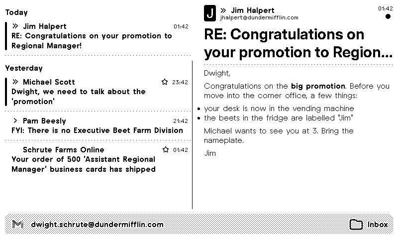

# TRMNL Email Messages Plugin

Display your recent emails directly on your TRMNL e-ink display with real-time IMAP synchronization.

## 📧 What It Does

This plugin connects to your email account via IMAP and displays your most recent messages. Perfect for keeping an eye on important emails without constantly checking your phone or computer.

## 🚀 Quick Start

1. **Choose your email provider** (Gmail, Outlook, Yahoo, iCloud, or Custom)
2. **Generate an app password** (required for security)
3. **Configure your preferences** (filters, display options, etc.)

## 🔧 How It Works

The plugin runs entirely inside TRMNL: its serverless code (`plugin/src/transform.py`, Python standard library only) logs in to your mail server over IMAP on every refresh and reads the subject, sender, date and read/flag state of your latest messages. There is no separate backend: your app password goes only from TRMNL to your mail server.

- A run stops after 4 seconds (TRMNL's limit is 5); `data.timing` shows how long each step took.
- When the mail server is briefly unreachable, the previous screen stays.

## 🧪 Tests

```bash
python3 -m pytest plugin/test     # serverless code against a fake IMAP server
cd plugin && trmnlp test          # every view and the error screen, with snapshots
```

## 🐛 Troubleshooting

### "Authentication failed"
- Ensure you're using an **app password**, not your regular password
- Verify 2FA is enabled (required for app passwords)
- Check that IMAP is enabled for your account

### Outlook Issues
- New Outlook accounts may have limited IMAP support
- Approve connection in [account activity](https://account.live.com/activity)
- Wait 20-30 minutes after creating app password


## 📄 License

MIT License - See LICENSE file for details


<!-- PLUGIN_STATS_START -->
##  [Email Messages (IMAP)](https://trmnl.com/recipes/198482)

 



### Description
Display your recent emails on your TRMNL display.<br /><br />
This plugin connects to your email account via IMAP and shows your latest messages with customizable filters and display options.<br /><br />
<strong>IMAP support:</strong> Works with Gmail, Outlook, Yahoo, iCloud, and custom IMAP servers<br />
<strong>Real-time updates:</strong> Shows the latest emails from your inbox<br />
<strong>Advanced filtering:</strong> Filter by sender, category, or importance<br />
<strong>Custom display:</strong> Control how emails appear on your screen


---

<!-- PLUGIN_STATS_END -->
